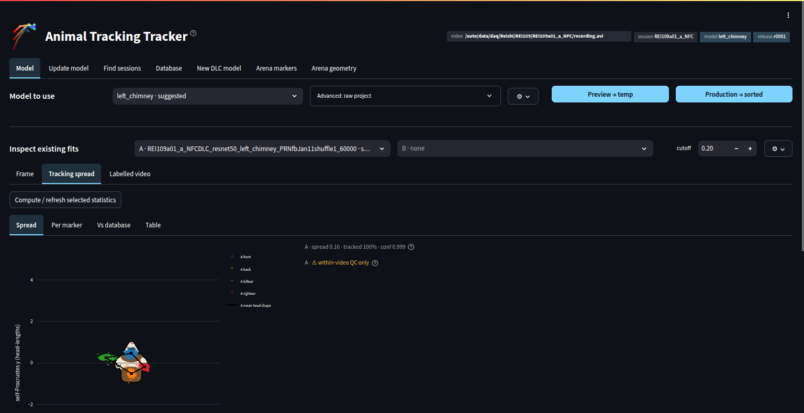

# Pose Tracking Manager

A Streamlit interface for managing DeepLabCut pose-tracking workflows in an auditory neuroscience lab. The application brings session discovery, model selection, inference, quality inspection, retraining, and arena annotation into one workspace.

The interface is titled **Animal Tracking Tracker**. This repository is a portfolio snapshot for [jwingert](https://github.com/jwingert), showcasing the application and its supporting implementation. Active development remains in [LBHB/nems_db](https://github.com/LBHB/nems_db).

## Interface



The **Model** section brings model selection and inference controls together with inspection of existing fits. Here, the **Tracking spread** view shows marker positions relative to the mean head shape, alongside tracking coverage and confidence summaries. The session, model, and release remain visible in the header.

## The problem it solves

Processing experimental video involves more than running a pose-estimation network. Different recording setups need different models; tracking results need inspection; and improved models need to be evaluated and released without overwriting the weights used for earlier analyses.

This application connects those tasks. An operator can open a session, see which model is suggested and why, submit analysis, inspect the resulting poses, and trace an output back to the model release that produced it. Separate views support improving the model and defining the arena geometry used in downstream analysis.

## How it works

The session and model remain visible in the header while the operator moves between seven sections:

| Section | Purpose |
| --- | --- |
| **Model** | Review the suggested model, select a release or project override, submit inference, inspect poses, and compare tracking outputs. |
| **Update model** | Evaluate a training project, add and curate labeled frames, retrain, and create or promote a model release. |
| **Find sessions** | Discover recordings and identify sessions that still need tracking or attention. |
| **Database** | Inspect the model registry, recorded fits, and tracking quality information. |
| **New DLC model** | Create a separate DeepLabCut project for a new tracking task. |
| **Arena markers** | Select a video frame, place arena landmarks, and save the arena configuration. |
| **Arena geometry** | Configure spatial scale, axes, fixation position, and speaker geometry. |

A typical workflow is:

1. Find a recording in **Find sessions**, or enter its video path in the header.
2. Open **Model** to review the routing suggestion and the resolved model release.
3. Submit tracking, then inspect the pose overlay and quality measurements when the job finishes.
4. If tracking needs improvement, use **Update model** to evaluate the model, curate additional labels, and retrain. Evaluate the resulting checkpoints before releasing an updated model.
5. Use **Arena markers** and **Arena geometry** to describe the recording environment for downstream analysis.

## Implementation highlights

- **Model provenance:** frozen model releases, release-stamped output filenames, and fit records connect tracking results to the weights that produced them.
- **Separate training and inference workflows:** model updates operate on mutable training projects, while released models provide stable inference inputs.
- **Shared backend logic:** routing, release management, fit recording, and quality checks live in Python modules used by the GUI and lab tools.
- **Interactive inspection:** video frames, pose overlays, plots, and tracking-quality summaries help operators assess results.
- **Stateful navigation:** shared session state retains model choices and edits as the operator moves between sections; the app renders the selected section.

## Code guide

The original directory structure is preserved so the copied files remain easy to compare with the lab repository.

| Location | Contents |
| --- | --- |
| [`behavior_config_labeler_tabs.py`](nems_lbhb/motor/streamlit_vid_labeler/behavior_config_labeler_tabs.py) | Application entry point, session header, and section navigation. |
| [`tabs/`](nems_lbhb/motor/streamlit_vid_labeler/tabs/) | The seven workflow sections. |
| [`labeler_core.py`](nems_lbhb/motor/streamlit_vid_labeler/labeler_core.py) | Shared state, UI helpers, file discovery, and workflow integration. |
| [`fit_inspection.py`](nems_lbhb/motor/streamlit_vid_labeler/fit_inspection.py) | Tracking-result inspection and comparison. |
| [`panels/`](nems_lbhb/motor/streamlit_vid_labeler/panels/) | Model routing, camera selection, and provenance panels. |
| [`nems_lbhb/motor/`](nems_lbhb/motor/) | Supporting model registry, releases, inference, quality checks, and training guards. |
| [`nems_lbhb/configs/`](nems_lbhb/configs/) | Lab-specific model routing and attribution configuration. |
| [`tests/`](tests/) | Copied regression tests for the GUI and supporting modules. |

The original [backend documentation](nems_lbhb/motor/README.md) provides additional implementation context. It also references lab tools outside this snapshot. The earlier single-page interface is retained as `behavior_config_labeler_plotly.py`.

## Running the application

This is a source-code showcase, not a self-contained installation or hosted demo. The copied code retains its original imports and lab-specific paths. Full operation requires the compatible `nems_db` environment, the lab database and job queue, shared video storage, and DeepLabCut projects and model weights.

The UI uses Streamlit, Plotly, OpenCV, NumPy, pandas, Matplotlib, Pillow, and TOML/YAML readers. DeepLabCut and the lab execution environment provide the training and inference functionality. Installing UI dependencies alone will not supply the lab services.

In a configured **lab checkout**, the existing application is launched from its own directory so Streamlit loads the included theme:

```bash
cd /path/to/nems_db/nems_lbhb/motor/streamlit_vid_labeler
streamlit run behavior_config_labeler_tabs.py
```

The tests are included as implementation examples and retain their original environment assumptions. This snapshot does not claim independent application or test-suite execution outside the lab checkout.

## Snapshot and maintenance

- **Snapshot date:** October 20, 2026.
- **Source:** the current working copy of `LBHB/nems_db`, branch `wingert_merge2`.
- **Base commit:** [`5a93fbef72f1ea68c50f4572cff17244d9359eb5`](https://github.com/LBHB/nems_db/commit/5a93fbef72f1ea68c50f4572cff17244d9359eb5).
- **Local changes included:** yes. The snapshot includes uncommitted GUI and backend changes and new source files, so the base commit alone does not reproduce it.
- **Scope:** the GUI, selected supporting modules, configuration, and relevant tests. The complete `nems_db` package, experimental videos, model weights, database exports, and local credentials are not included.

Copied source files are preserved unchanged. Development and fixes continue in the lab repository; this portfolio copy may be refreshed occasionally and is not automatically synchronized.

## Credits

Developed in the [Laboratory of Brain, Hearing and Behavior](https://github.com/LBHB) as part of `nems_db`, using [DeepLabCut](https://github.com/DeepLabCut/DeepLabCut) for pose estimation. Existing source comments and attribution are retained. See [LICENSE](LICENSE) for this repository's license; dependencies retain their respective licenses.
